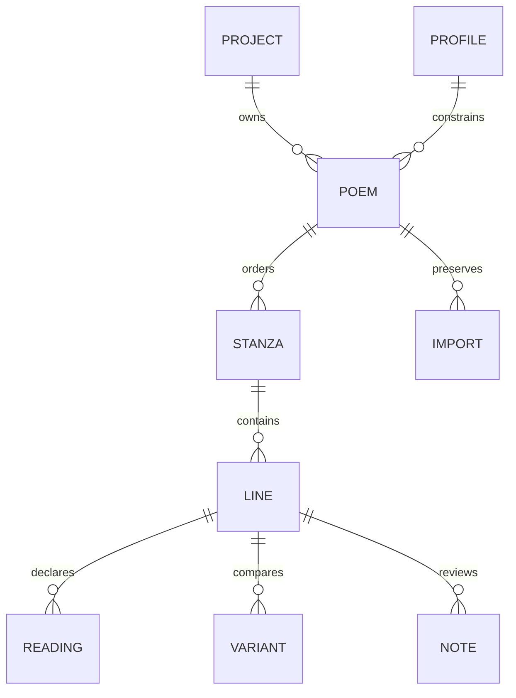

# 领域与本体设计

## 专业聚合与事实归属

Poem诗篇、Stanza诗节、Line诗行、Profile声明规则、Variant逐句备选、Note固定意见、Import原件。一个专业工程内维护相关集合，避免为每个小对象建立数据库或独立服务。根字段为poems、stanzas、lines、profiles、variants、notes、imports、basis_refs。

作品、正式正文、设定、原始资料、素材和事务归宿主Core。专业对象及其固定修订属于本包；跨插件依据固定owner_plugin_id、object_id、revision和sha256。WorkRef区分小说、剧本、视频，同一名字、ID片段或目录不扩大授权。

## 不变量

一行只能有一行文本，顺序在诗节内唯一；每个字的读音／平仄按位置显式记录，未知不猜。Profile固定名称、规则出处、每句模式与韵组，P／Z／*只按声明体系比较；字符计数不是音节。传统与现代方案不得混用。备选固定原句SHA，使用后清空旧音韵标注并保留旧意见；用典引文按UTF-8字节核对，不把借鉴标成引用。

所有集合ID在自身范围唯一；任何引用必须存在，顺序在各自父级内唯一。移除被引用项前先显式处理关系，整本保存也不能绕过原件和核实记录的历史保护。来源只追加，不能将已有索引改指另一份材料。

## 解释与作者决定

程序执行可重复规则，Agent解释与准备候选，作者保留取舍、采纳和定稿。专业状态只是检查依据；无法判断时保留缺口，不能用默认值掩盖。内容改变形成新专业修订，旧意见坐标和依据不静默移到新稿。
