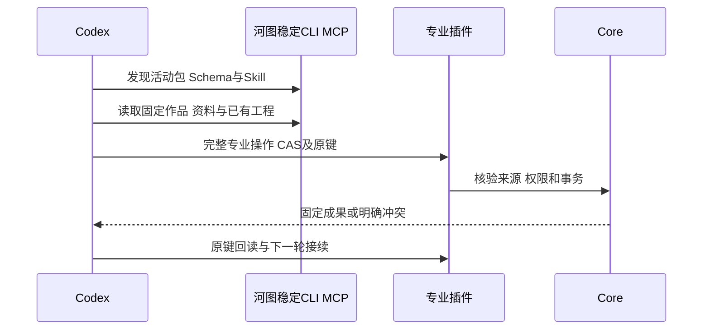

# 数据与API设计

## 格式与数据库

manifest_version=1、Host API=1、format_version=1、专业schema_version=1.0.0。可执行字段及动作参数由`contracts/plugin-manifest.json`维护；构建期Ajv生成静态校验器，后端不使用eval，视图不编译Schema。

复用Core专业对象与不可变JSON修订，无独立SQL库、Migration、原稿目录或第三方账户。身份键为WorkRef＋owner_plugin_id＋object_id，固定版本为revision＋sha256，更新必须CAS。单工程512KiB、最多100来源；每类专业集合设明确上限，字段及精确限制以可执行Schema为准。

## 机器入口

稳定动作`hetu.plugins.inspect`→`hetu.plugins.capabilities`→`skills.read`→`hetu.plugins.invoke`。外层携带management_ref、WorkRef、plugin_id、package_sha256和capabilities_sha256。新建expected_revision=0、expected_sha256为空；更新携带确切基线、完整输入和原operation_key。

通用动作包括list_projects、get_project、save_project、get_source、get_basis、compare_versions、export_project、build_context、create_handoff和get_operation；可编辑集合通过专用put／remove动作维护；采访原话、固定证据、核实历史及身份辨析等只追加记录不提供删除动作，精确行为以专业合同为准。专业动作：check_poetry、scan_poem、line_digest、profile_report、collection_order、preview_poem、import_poem、apply_variant、export_reading、export_review。完整清单由本包CAPABILITIES与包内操作地图生成；不把它复制到宿主能力清单。

固定引文使用UTF-8字节半开区间，先公开回读，再定位原文；错误摘要、错区间或改字不得落盘。跨插件依据只读当前作品的固定成果，不借用另一作品管理权限。

## 错误、导出与演进

同键同参返回原结果，同键异参拒绝；写后超时先get_operation，不换键重发。CAS冲突保留输入，明确读最新基线后重新准备差异。停用、卸载、旧包绑定和撤权不能继续执行，但已有成果与历史修订不被清理。

专业TXT和HTML返回offset、max_bytes、base64、chunk_sha256、total_bytes、sha256与next_offset，先逐块再核验完整文件。桌面通过宿主save_artifact保存固定对象与字节，作者选择目标、取消保护和原子写入沿宿主0.12.6公共合同；机器直接读同一分块，无GUI前置。

格式升级先更新数据语义、转换规则和Schema，再发布新包；Host API、专业格式与包版本各有职责。旧固定引用不变，不覆盖公开同版本附件。
