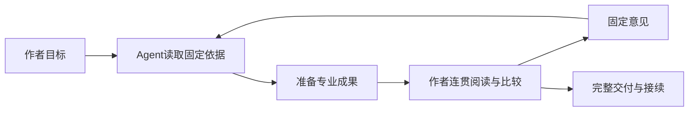

# 工作面与交互设计

独立专业工作面，顶部紧凑保留返回作品、刷新与让AI处理。五页：诗集阅读、音韵与形式、用典依据、逐句比较、诗集交付。作者先阅读已有成果，历史、技术细节和手动维护渐进展开；不让表格或JSON成为默认内容。

实际使用示例：“按雨港来信写两首短诗，一首自由诗、一首使用我提供的五字规则。保留用典出处，比较首句，不替我判断哪版更好。”Agent读取固定输入并准备完整操作，作者在对应页比较理由、依据和旧版意见。每页的交接带明确对象、修订、当前任务及恢复路径。

空状态说明缺什么及下一步；读取中、错误、部分依据、unknown、冲突和成功分别显示。意见绑定当前目标摘要，版本变化显示待复核；高级编辑遇到CAS保留原输入，读取新基线须明确操作，关闭重开恢复未保存稿。

沿共享Radix色板和静止连续纸色／玉色渐变，覆盖完整长文档；输入和正文纸面稳定实色。12／14／18／20px最多四档，细边框0.5px、键盘可辨识，无装饰动画。浅暗、正常／窄窗、减少透明度与增强对比度分别验证。

验收循环观察真实工作面、对照布局、间距、排版、颜色、状态和交互，发现问题后修正复拍。六项达到9分属于有依据的设计判断，不冒充自动像素认证；未验证项如实列出。
